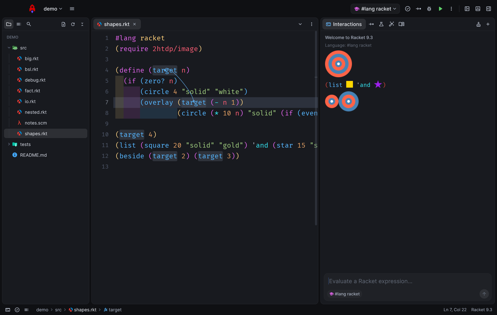
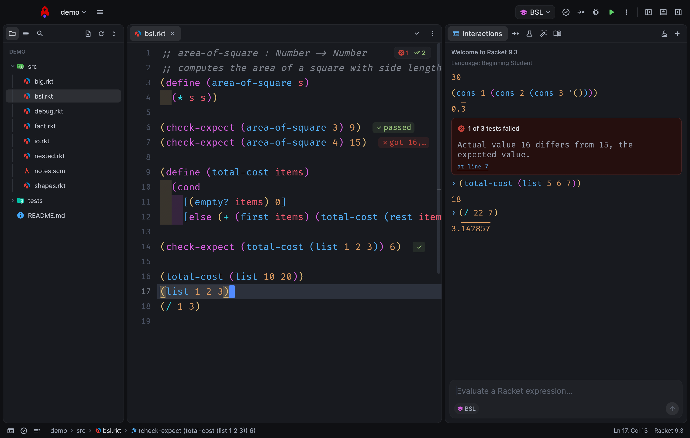
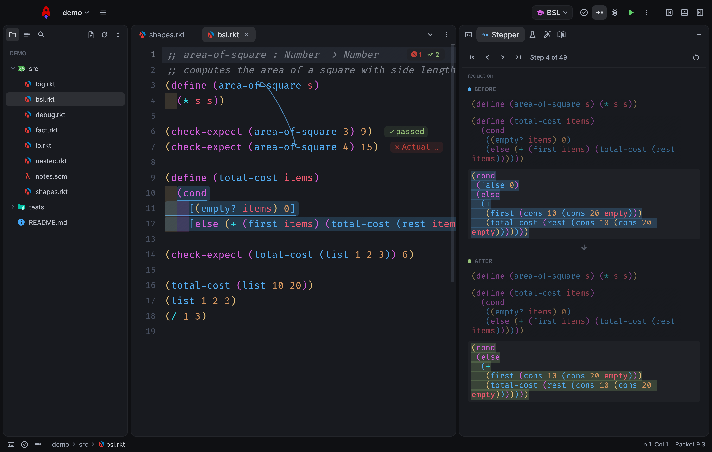
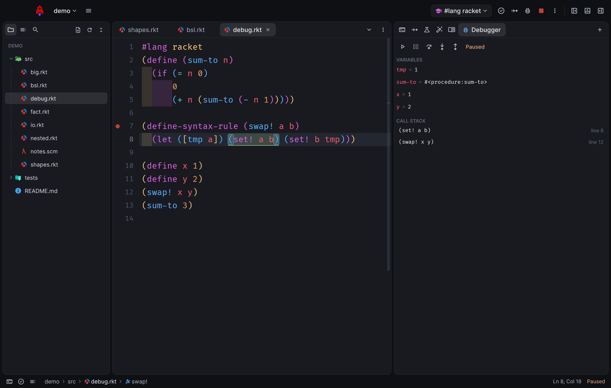
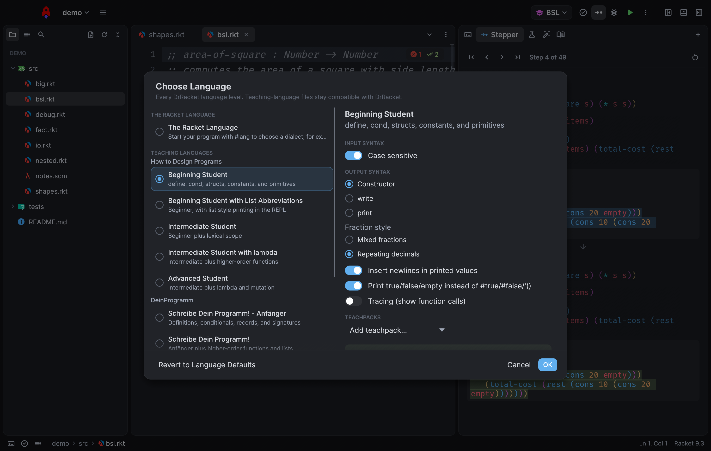
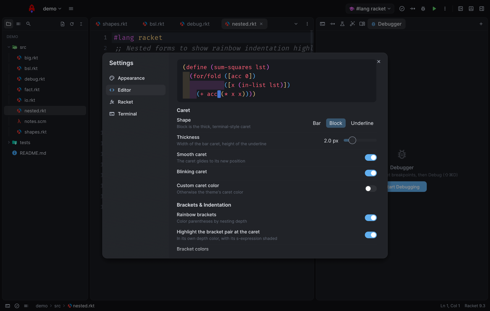
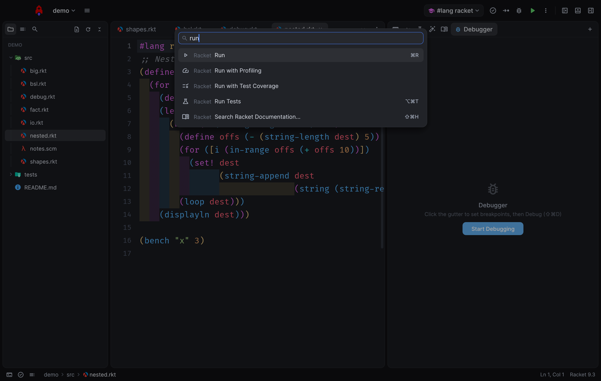

<p align="center">
  
</p>

<h1 align="center">Dr. Rocket</h1>

<p align="center">A fast, modern IDE for Racket, written in Rust. Everything DrRacket does, in an editor that feels like Zed.</p>



## Why

DrRacket is the reference Racket environment, but it looks and feels dated. Dr. Rocket keeps
every DrRacket feature, using Racket's own stepper, check-syntax, debugger and test engine
under the hood, and puts them in a GPU-rendered editor with a file tree, tabs, a command palette,
integrated terminals and themes. Teaching-language files stay byte-compatible with DrRacket.

## Features

**From DrRacket**

- **Definitions + Interactions**: Run (⌘R), Break (⌘.), Kill (⌘K), and a REPL with history, multi-line
  input, stdin prompts, images inline (2htdp/image, picts), and errors linked to their source
- **Every language level**: The Racket Language (`#lang`), Beginning Student, Beginning Student with
  List Abbreviations, Intermediate Student, Intermediate Student with lambda, Advanced Student,
  DeinProgramm (Anfänger, Fortgeschritten, mit Zuweisungen), R5RS and Pretty Big, plus output
  style, fraction style, sharing, tracing and teachpacks (Choose Language, ⌘L)
- **Algebraic stepper** (⇧⌘E) with before/after highlighting, mirrored in the source, step for
  step identical to DrRacket's, with images drawn in the steps
- **DrRacket files with pasted images and comment boxes** open with the images inline, run, and
  save back in DrRacket's format; Insert Image… and pasting images from the clipboard
- **Check syntax**, running continuously in the background: binding arrows, unused bindings and
  requires, hover info, rename (F2), go to definition across files (F12 / ⌘-click)
- **Debugger** (⇧⌘D): gutter breakpoints, step into/over/out, locals and call stack. As in
  DrRacket, required modules open in other tabs are debugged too, using their unsaved text
- **Tests**: check-expect and rackunit results, with ✓/✗ chips on each test line
- **Test coverage**, **profiler**, **macro stepper** (⇧⌘M) and **module browser**
- **Docs**: the signature "blue box" for the call at the cursor, hover docs, and search over all
  installed manuals (F1)
- Racket indentation (Tab, ⌘I), s-expression navigation, Comment Out with a Box / `#;`, λ (⌘\\),
  Create Executable, Revert, Save Interactions, Print, Show Log, and package install, update and
  removal

**Beyond DrRacket**

- **Visualizer** (⇧⌘V): replays a run as an animated diagram. Call frames, cons-cell chains and
  trees (structs that point to their own type) are drawn and animate as the program changes them,
  with a plain-language explanation of each step and the step's code highlighted. Tail calls
  replace their caller's frame, as Racket runs them.
- Project tabs, integrated terminals, Zed themes, and the editor features below

**Editor**

- Recent projects, a file tree with Material icons, project-wide search, quick open (⌘P) and a
  command palette (⇧⌘P)
- Docks you can rearrange: put any panel, terminals included, in the left, right or bottom dock
- Integrated terminals (⌃`), with full colour, mouse support and scrollback
- Themes: built-in themes plus every Zed theme you have installed. The default, Moiz One Dark, is
  the One Dark Darker Zed theme (a test checks the colours match it exactly).
- Fira Code with ligatures, rainbow brackets with palette presets, rainbow indentation
  highlights, a smooth configurable caret, sticky scroll, multi-cursor, completion,
  find/replace, autosave and session restore
- Fast on big files: incremental lexing, and only visible lines are laid out. A keystroke on a
  20,000-line file costs about 0.2 ms, and the app uses 0% CPU when idle.

| | |
|---|---|
|  |  |
|  |  |
|  |  |

## Install

Requires [Racket](https://racket-lang.org) (tested with 9.3; found automatically in `PATH`, Homebrew,
`/Applications/Racket*` or `C:\Program Files\Racket`) and a Rust toolchain.

```sh
tools/bundle.sh --install            # builds "Dr. Rocket.app" and copies it to ~/Applications
tools/bundle.sh --universal --dmg    # Apple Silicon + Intel app and a DMG for distribution
```

Distribution signing and notarization happen when `DEVELOPER_ID` and `NOTARY_PROFILE` are set
(see `tools/bundle.sh`). The code also builds on Windows and Linux; CI runs the full test suite
there with Racket. See [docs/drracket-parity.md](docs/drracket-parity.md) for what is and isn't
covered compared with DrRacket.

Or run it straight from the tree:

```sh
cargo run --release -- path/to/file-or-folder
```

## Keyboard shortcuts

| Action | Keys | Action | Keys |
|---|---|---|---|
| Run | ⌘R | Command palette | ⇧⌘P |
| Break / Kill | ⌘. / ⌘K | Go to file | ⌘P |
| Stepper | ⇧⌘E | Go to definition in file | ⇧⌘. |
| Debug | ⇧⌘D | Go to definition | F12 / ⌘-click |
| Check syntax | ⇧⌘C | Rename | F2 |
| Choose language | ⌘L | Documentation | F1 / ⇧⌘H |
| Reindent all | ⌘I | Toggle comment | ⌘/ |
| Expand / shrink selection | ⌥⇧→ / ⌥⇧← | Forward / back s-expression | ⌃⌥→ / ⌃⌥← |
| Toggle left / right / bottom dock | ⌘B / ⌘E / ⌘J | New terminal | ⌃` |

## How it works

The Rust app (egui on wgpu) owns the editor, layout and rendering. All Racket semantics run in
Racket processes, speaking newline-delimited JSON: a **runner** per Run (REPL, errortrace,
coverage, profiler, debugger), a **stepper** driving DrRacket's stepper model, and a long-lived
**server** for check syntax, docs, completions, macro steps and the module graph. See
[DESIGN.md](DESIGN.md).

Development:

```sh
cargo test                        # unit + backend integration tests (needs Racket)
cargo clippy --all-targets        # kept warning-free
tools/dev.sh                      # live dev loop: rebuild and restart on change, themes reload live
DRROCKET_AUTOMATION=script.json cargo run   # scripted end-to-end runs with screenshots
cargo run --example make_icon     # regenerate the app icon from assets/SVG
```

## Credits

File icons: [Material Icon Theme](https://github.com/material-extensions/vscode-material-icon-theme) (MIT).
UI glyphs: [Material Symbols](https://github.com/google/material-design-icons) (Apache 2.0).
Fonts: Fira Code and Inter (SIL OFL).
