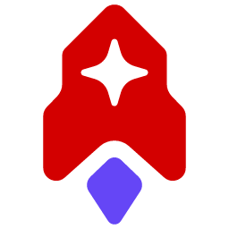
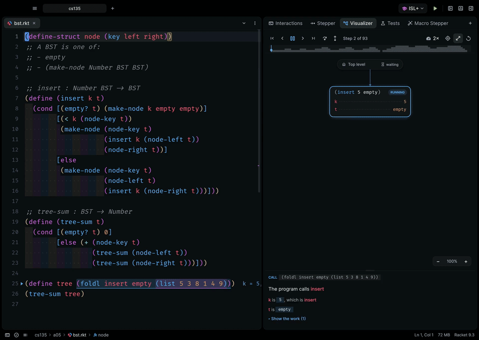
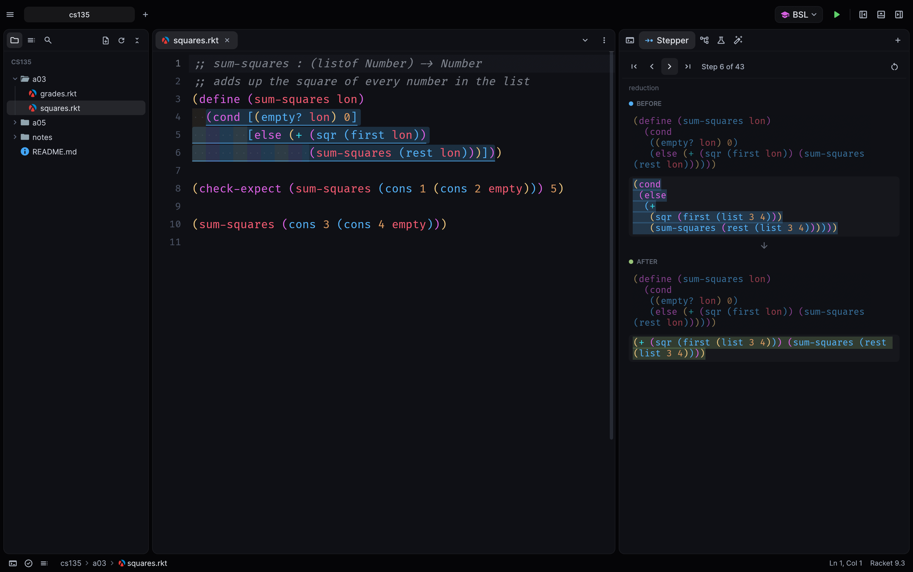
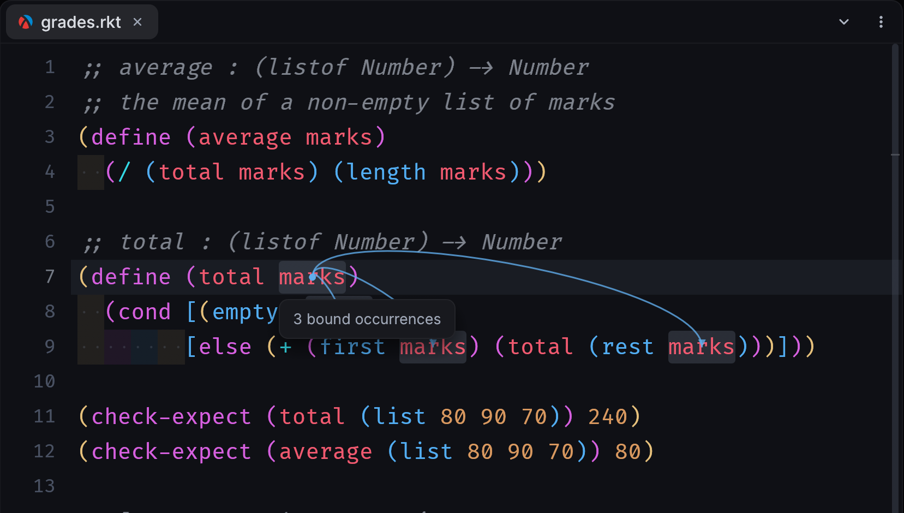
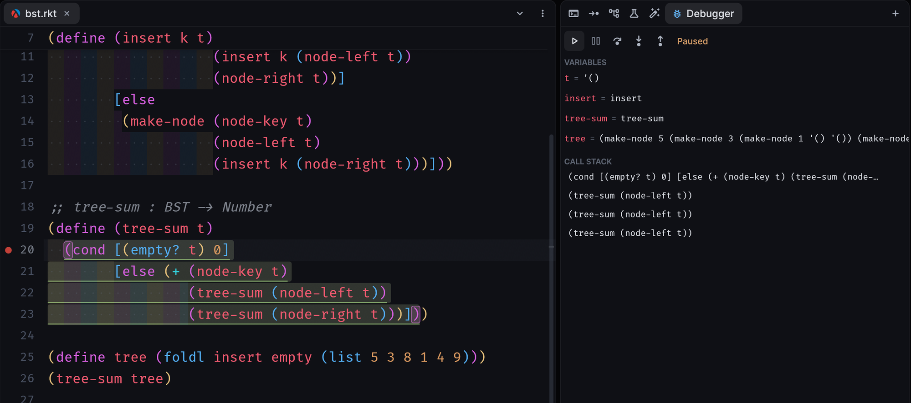
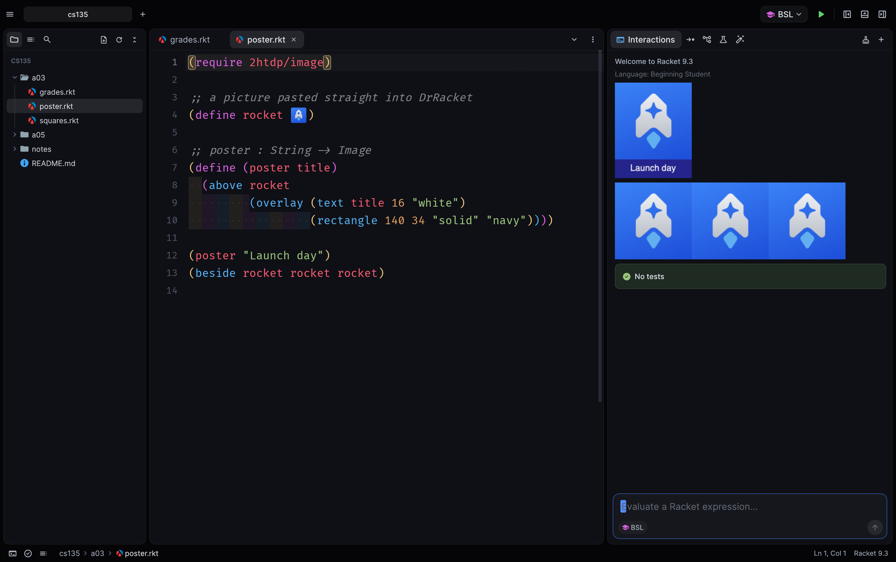
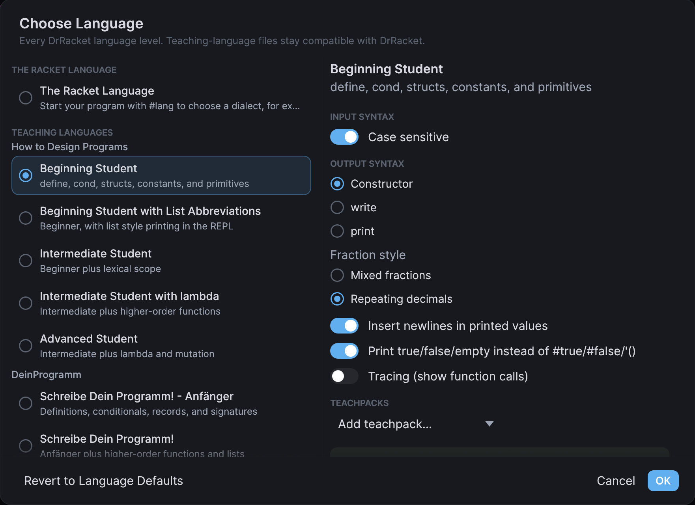
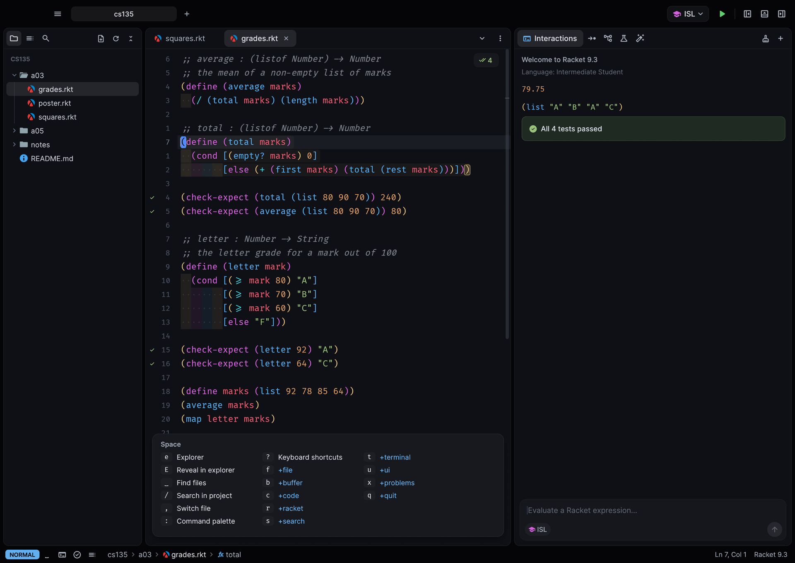
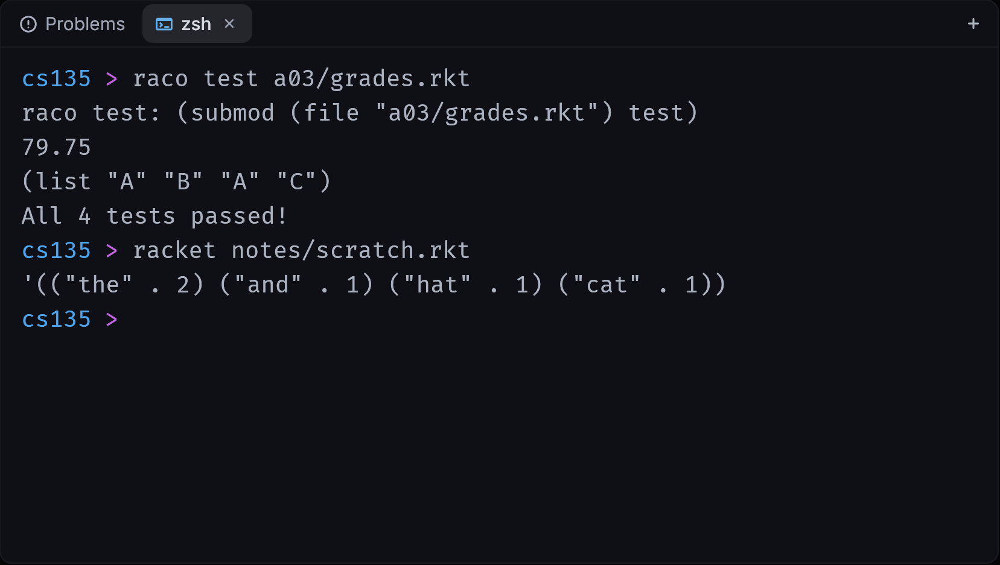
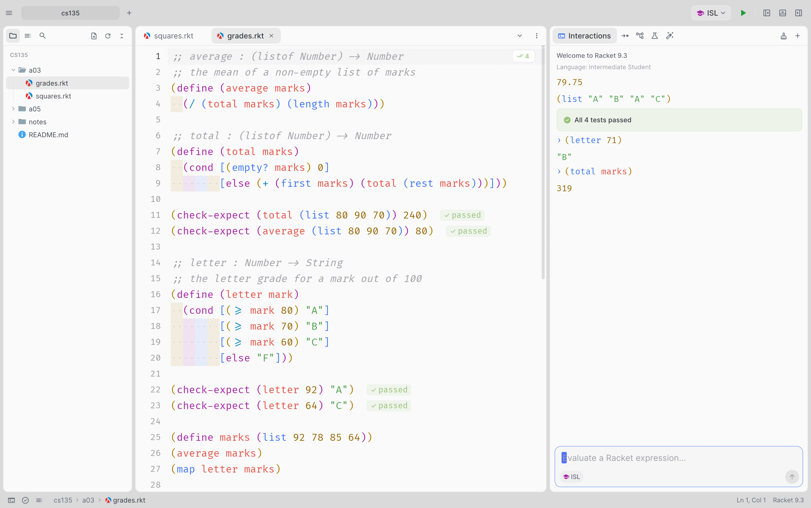

<p align="center">
  <a href="https://doctorocket.com"></a>
</p>

<h1 align="center">Dr. Rocket</h1>

<p align="center">
  <b>Everything DrRacket does, at native speed.</b><br>
  A Racket IDE written in Rust, with a Visualizer that draws your program as it runs.
</p>

<p align="center">
  <a href="https://doctorocket.com"></a>
  
  
  
  
</p>

<p align="center">
  <a href="https://doctorocket.com/download/mac"></a>
  <a href="https://doctorocket.com/download/windows"></a>
  <a href="https://doctorocket.com/download/linux"></a>
</p>

<p align="center"><a href="https://doctorocket.com">doctorocket.com</a></p>

<br>

<p align="center">
  <a href="https://doctorocket.com"></a>
</p>
<p align="center"><sub>The Visualizer replaying a binary search tree program. Watch the tree grow as <code>insert</code> runs.</sub></p>

<br>

## Why Dr. Rocket

DrRacket is where everyone learns Racket, and it looks and feels like it was built a long time
ago. Dr. Rocket keeps **every DrRacket feature**, running Racket's own stepper, check syntax,
debugger and test engine under the hood, and puts them in a GPU-rendered editor with a file tree,
tabs, a command palette, terminals, themes and Vim keys. Teaching-language files stay
byte-compatible with DrRacket, so you can hand in exactly what your course expects.

<table>
  <tr>
    <td width="33%" valign="top">
      <h3>⚡ Native speed</h3>
      Written in Rust and drawn on the GPU. A keystroke in a 20,000-line file takes about 0.2 ms,
      and the app sits at 0% CPU when idle.
    </td>
    <td width="33%" valign="top">
      <h3>🎓 Every language level</h3>
      Beginning Student through Advanced Student, <code>#lang</code>, DeinProgramm, R5RS and Pretty
      Big, with the same output, stepper and error messages as DrRacket.
    </td>
    <td width="33%" valign="top">
      <h3>🔭 See your program run</h3>
      The Visualizer draws call frames, lists and trees as they change, and explains every step in
      plain words.
    </td>
  </tr>
</table>

## The Visualizer

Press <kbd>⇧</kbd><kbd>⌘</kbd><kbd>V</kbd> and Dr. Rocket replays your program as an animated
diagram.

- **Call frames** for every live call, with their arguments and what they return. Tail calls
  replace their caller's frame, exactly as Racket runs them.
- **Real data structures.** Lists are drawn as chains and structs that point to their own type
  as trees, with left and right children, empty slots and new nodes popping in.
- **Explanations in plain words.** `(empty? t)` reads as *"Is t empty? No"*, with each value as a
  coloured chip that matches its ring in the diagram. Arithmetic shows its work.
- **Notes in the editor.** Each step's values appear beside its code, so you never lose your place.
- **Navigation.** Step over, back over and out (<kbd>⇧</kbd> + arrows), jump to the next step on
  the cursor's line, and scrub a recursion graph of the whole run.

## Everything from DrRacket

<table>
  <tr>
    <td width="50%"></td>
    <td width="50%" valign="middle">
      <h3>Algebraic stepper</h3>
      <kbd>⇧</kbd><kbd>⌘</kbd><kbd>E</kbd> steps through the teaching languages the way
      DrRacket's stepper does, step for step, with before and after highlighted and mirrored in
      your source. Images are drawn right in the steps.
    </td>
  </tr>
  <tr>
    <td width="50%" valign="middle">
      <h3>Check syntax and binding arrows</h3>
      Runs continuously in the background: arrows from each use to its definition, unused
      bindings, hover info, rename (<kbd>F2</kbd>) and go to definition across files
      (<kbd>F12</kbd> or <kbd>⌘</kbd>-click).
    </td>
    <td width="50%"></td>
  </tr>
  <tr>
    <td width="50%"></td>
    <td width="50%" valign="middle">
      <h3>Debugger</h3>
      <kbd>⇧</kbd><kbd>⌘</kbd><kbd>D</kbd>: gutter breakpoints, step into, over and out, locals
      and the call stack. Required modules open in other tabs are debugged too, unsaved text
      included.
    </td>
  </tr>
  <tr>
    <td width="50%" valign="middle">
      <h3>Your DrRacket files, images and all</h3>
      Files with pasted images and comment boxes open with the images inline, run, and save back
      in DrRacket's format. Paste images straight from the clipboard.
    </td>
    <td width="50%"></td>
  </tr>
  <tr>
    <td width="50%"></td>
    <td width="50%" valign="middle">
      <h3>Every language, every option</h3>
      Choose Language (<kbd>⌘</kbd><kbd>L</kbd>) has all of DrRacket's levels and their settings:
      output style, fractions, sharing, tracing and teachpacks.
    </td>
  </tr>
</table>

Also from DrRacket: **Definitions and Interactions** (Run <kbd>⌘</kbd><kbd>R</kbd>, Break,
Kill, a REPL with history, multi-line input and images inline), **tests** (`check-expect` and
rackunit, with ticks in the gutter and failures inline), **test coverage**, the **profiler**, the
**macro stepper**, the **module browser**, **docs** (the signature blue box, hover docs and search
over every installed manual with <kbd>F1</kbd>), Racket indentation, s-expression navigation,
comment boxes, λ (<kbd>⌘</kbd><kbd>\\</kbd>), Create Executable and package management.

## Vim mode

<p align="center"></p>

Turn it on in **Settings → Keybindings**. It's Neovim with a LazyVim-style Space leader:

- **Normal, insert and visual modes**, with operators (`d` `c` `y` `>` `<` `=` `gu` `gU` `gc`),
  motions (`w` `b` `e` `f` `t` `%` `{` `}` `gg` `G` `*` `n`...), text objects (`ciw`, `di(`,
  `ya"`, `vip`...), counts, registers, marks, macros and `.`
- **Space opens which-key.** <kbd>Space</kbd> <kbd>e</kbd> toggles the sidebar,
  <kbd>Space</kbd> <kbd>f</kbd> <kbd>f</kbd> finds files, <kbd>Space</kbd> <kbd>r</kbd>
  <kbd>r</kbd> runs, <kbd>Space</kbd> <kbd>r</kbd> <kbd>v</kbd> visualizes
- **`:` opens a command menu**: `:w`, `:q`, `:wq`, `:%s/old/new/g`, `:42`, and every app
  command (`:Visualize`, `:Run`, `:Format`...)
- **Insert-mode keys**: <kbd>⌃W</kbd> <kbd>⌃U</kbd> <kbd>⌃T</kbd> <kbd>⌃D</kbd> <kbd>⌃R</kbd>
  <kbd>⌃O</kbd>, plus relative line numbers and a flash on every yank, which goes straight to the
  system clipboard

## A modern editor

- **Projects** with a file tree, project tabs, project-wide search, quick open
  (<kbd>⌘</kbd><kbd>P</kbd>) and a command palette (<kbd>⇧</kbd><kbd>⌘</kbd><kbd>P</kbd>)
- **Docks you can rearrange.** Put any panel, terminals included, on the left, right or bottom
- **Integrated terminals** (<kbd>⌃</kbd><kbd>`</kbd>) with full colour, mouse support and scrollback
- **Themes**: built-in themes plus every Zed theme you have installed. The default, Moiz One Dark,
  matches Zed's One Dark Darker exactly (a test checks it)
- Fira Code with ligatures, rainbow brackets and indentation, a smooth caret, sticky scroll,
  multi-cursor, completion, find and replace, per-file zoom, autosave and session restore

<table>
  <tr>
    <td width="50%"></td>
    <td width="50%"></td>
  </tr>
</table>

## Install

**Download** the beta for [macOS](https://doctorocket.com/download/mac) (Apple Silicon and
Intel), [Windows](https://doctorocket.com/download/windows) or
[Linux](https://doctorocket.com/download/linux), and install
[Racket](https://racket-lang.org) if you don't have it. Dr. Rocket finds it on its own (in your
`PATH`, Homebrew, `/Applications/Racket*` or `C:\Program Files\Racket`).

> [!NOTE]
> The beta isn't code-signed yet. On macOS, right-click the app and choose **Open** the first
> time. On Windows, click **More info → Run anyway**.

**Or build it** with a Rust toolchain:

```sh
cargo run --release -- path/to/file-or-folder   # run straight from the tree
tools/bundle.sh --install                       # build "Dr. Rocket.app" into ~/Applications
tools/bundle.sh --universal --dmg               # Apple Silicon + Intel app and a DMG
```

Signing and notarization happen when `DEVELOPER_ID` and `NOTARY_PROFILE` are set (see
`tools/bundle.sh`). See [docs/drracket-parity.md](docs/drracket-parity.md) for exactly what is
and isn't covered compared with DrRacket.

## Keyboard shortcuts

| Action | Keys | Action | Keys |
|---|---|---|---|
| Run | <kbd>⌘R</kbd> | Command palette | <kbd>⇧⌘P</kbd> |
| Break / Kill | <kbd>⌘.</kbd> / <kbd>⌘K</kbd> | Go to file | <kbd>⌘P</kbd> |
| Visualize | <kbd>⇧⌘V</kbd> | Go to definition | <kbd>F12</kbd> / <kbd>⌘</kbd>-click |
| Stepper | <kbd>⇧⌘E</kbd> | Rename | <kbd>F2</kbd> |
| Debug | <kbd>⇧⌘D</kbd> | Documentation | <kbd>F1</kbd> |
| Choose language | <kbd>⌘L</kbd> | Toggle comment | <kbd>⌘/</kbd> |
| Reindent all | <kbd>⌘I</kbd> | Select all occurrences | <kbd>⇧⌘L</kbd> |
| Next / previous file tab | <kbd>⌃Tab</kbd> / <kbd>⌃⇧Tab</kbd> | Zoom this file | <kbd>⌘+</kbd> / <kbd>⌘-</kbd> / <kbd>⌘0</kbd> |
| Left / right / bottom dock | <kbd>⌘B</kbd> / <kbd>⌘E</kbd> / <kbd>⌘J</kbd> | New terminal | <kbd>⌃`</kbd> |

On Windows and Linux, <kbd>Ctrl</kbd> takes the place of <kbd>⌘</kbd>.

## How it works

The Rust app (egui on wgpu) owns the editor, layout and rendering. Everything Racket runs in
Racket processes that speak newline-delimited JSON:

```
┌────────────────── Dr. Rocket (Rust: egui + wgpu) ─────────────────────┐
│     editor · panels · Visualizer · terminals · themes · Vim           │
└───────┬─────────────────────────┬──────────────────────────┬──────────┘
        │ JSON lines              │                          │
┌───────▼────────┐       ┌────────▼────────┐       ┌─────────▼──────────┐
│ runner per Run │       │     stepper     │       │ long-lived server  │
│                │       │                 │       │                    │
│ REPL, errors,  │       │ DrRacket's own  │       │ check syntax, docs │
│ debugger,      │       │ stepper model   │       │ completions, macro │
│ profiler,      │       │                 │       │ steps, module      │
│ coverage, viz  │       │                 │       │ graph              │
└────────────────┘       └─────────────────┘       └────────────────────┘
```

See [DESIGN.md](DESIGN.md) for the details.

### Development

```sh
cargo test                        # unit and backend integration tests (needs Racket)
cargo clippy --all-targets        # kept warning-free
tools/dev.sh                      # rebuild and restart on every change; themes reload live
DRROCKET_AUTOMATION=script.json cargo run   # scripted end-to-end runs with screenshots
```

## Credits

File icons: [Material Icon Theme](https://github.com/material-extensions/vscode-material-icon-theme) (MIT).
UI glyphs: [Material Symbols](https://github.com/google/material-design-icons) (Apache 2.0).
Fonts: Fira Code and Inter (SIL OFL). Dr. Rocket is not affiliated with the Racket project; it
runs the Racket you install from [racket-lang.org](https://racket-lang.org).
